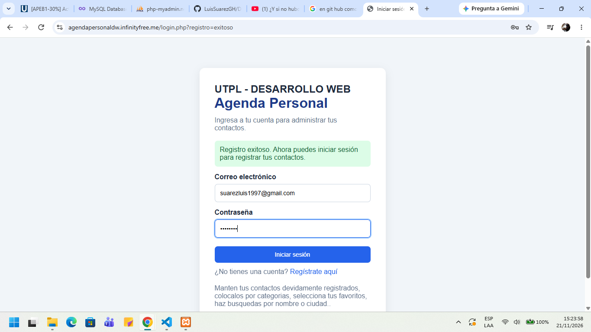
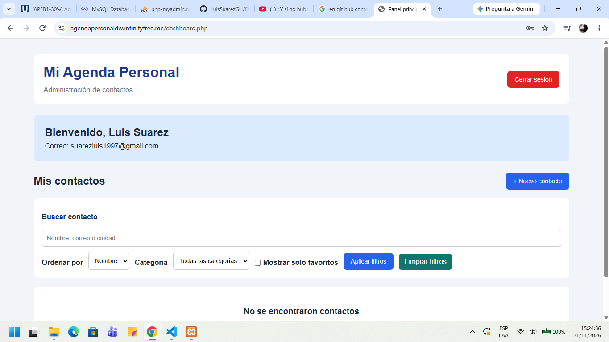
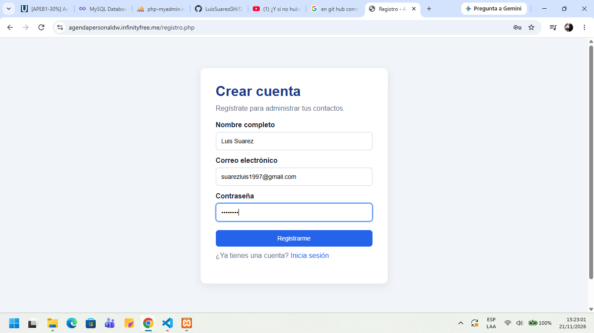
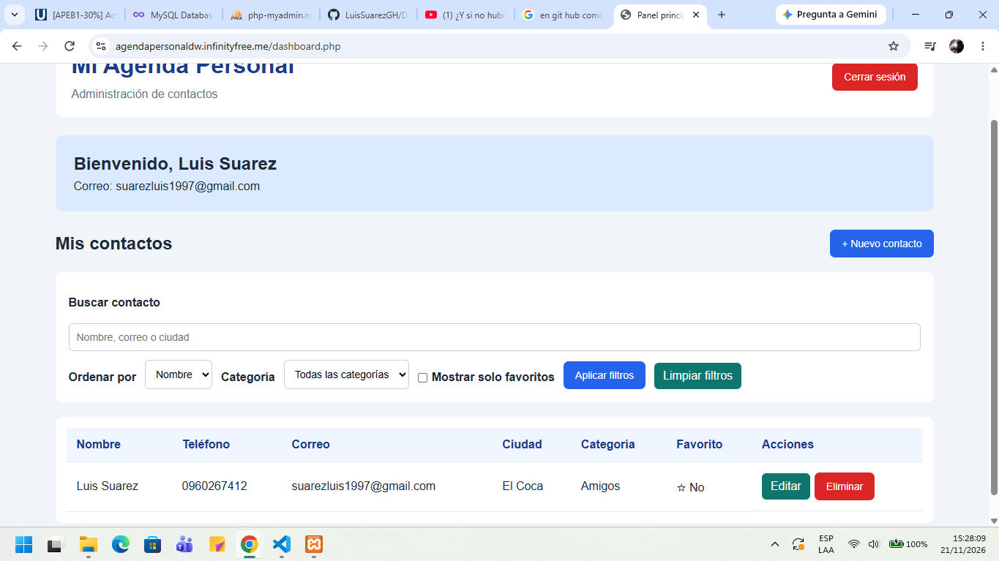
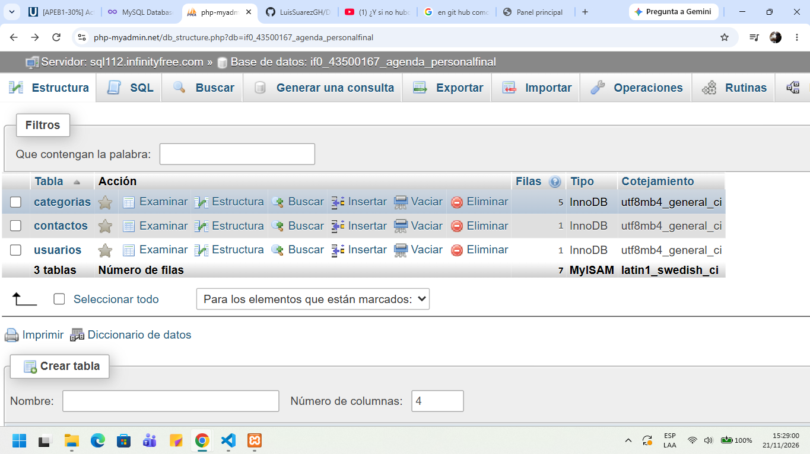

# Desarrollo WEB - ACDB1
# Agenda Personal de Contactos

## 1. Descripción del proyecto

Agenda Personal de Contactos es una aplicación web desarrollada en PHP y MySQL que permite administrar información de contactos personales mediante una interfaz sencilla y segura.

La aplicación permite registrar usuarios, iniciar sesión y gestionar contactos, incorporando herramientas de búsqueda, clasificación por categorías y administración de favoritos.

## 2. Objetivo

Desarrollar y desplegar una aplicación web para la gestión de contactos personales, aplicando tecnologías de desarrollo web, conexión con bases de datos y mecanismos básicos de seguridad.

## 3. Tecnologías utilizadas

- **PHP:** desarrollo de la lógica del servidor.
- **MySQL:** almacenamiento y administración de información.
- **HTML5:** estructura de las páginas.
- **CSS3:** diseño y presentación de la interfaz.
- **XAMPP:** entorno de desarrollo local.
- **phpMyAdmin:** administración de la base de datos.
- **Git y GitHub:** control de versiones y almacenamiento del código.
- **InfinityFree:** alojamiento web gratuito.

## 4. Funcionalidades principales

- Registro de usuarios.
- Inicio y cierre de sesión.
- Registro de contactos.
- Edición de información de contactos.
- Eliminación de contactos.
- Visualización de contactos registrados.
- Protección de información mediante sesiones.

## 5. Mejoras implementadas

**1. Búsqueda de contactos**

Permite buscar contactos por nombre, correo electrónico o ciudad.

**2. Ordenamiento de contactos**

Permite organizar los registros alfabéticamente por nombre o ciudad.

**3. Clasificación por categorías**

Permite clasificar los contactos en las siguientes categorías:

- Familia.
- Amigos.
- Trabajo.
- Universidad.
- Otro.

**4. Administración de favoritos**

Permite marcar contactos como favoritos y filtrar la lista para visualizar únicamente los contactos destacados.

## 6. Seguridad implementada

- Contraseñas almacenadas mediante `password_hash()`.
- Verificación de contraseñas mediante `password_verify()`.
- Consultas preparadas con PDO.
- Control de acceso mediante sesiones.
- Regeneración del identificador de sesión al iniciar sesión.
- Protección CSRF mediante tokens.
- Protección de salida HTML contra ataques XSS.

## 7. Instalación y ejecución local

1. Instalar XAMPP.
2. Iniciar los servicios Apache y MySQL.
3. Copiar el proyecto en la carpeta `htdocs`.
4. Abrir phpMyAdmin.
5. Crear la base de datos `agenda_personal`.
6. Importar el archivo `agenda_personal.sql`.
7. Configurar las credenciales de conexión en `config/database.php`.
8. Abrir el navegador e ingresar a:

`http://localhost/agenda_personal/`

## 8. Despliegue web

La aplicación se encuentra alojada en InfinityFree.

**URL pública:** https://agendapersonaldw.infinityfree.me

## 9. Base de datos

El proyecto utiliza una base de datos MySQL compuesta por tres tablas principales:

- `usuarios`: almacena la información de los usuarios.
- `contactos`: almacena los contactos registrados.
- `categorias`: contiene las categorías disponibles.

El archivo `agenda_personal.sql` contiene el script necesario para crear la estructura de la base de datos.

## 10. Autor

Proyecto académico desarrollado como parte de la actividad práctica de desarrollo web.

**Repositorio GitHub:**  
https://github.com/LuisSuarezGH/DESARROLLOWEB_ACDB1_AGENDAPERSONAL

## 11. Evidencias del proyecto

### Inicio de sesión

### Panel principal

### Registro de contactos

### Búsqueda y filtros

### despliegue en InfinityFree

